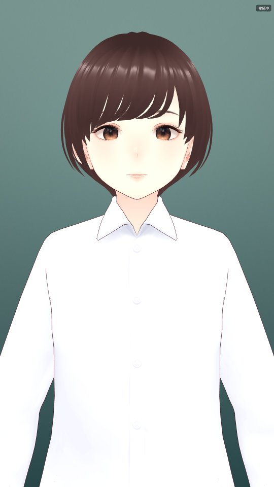
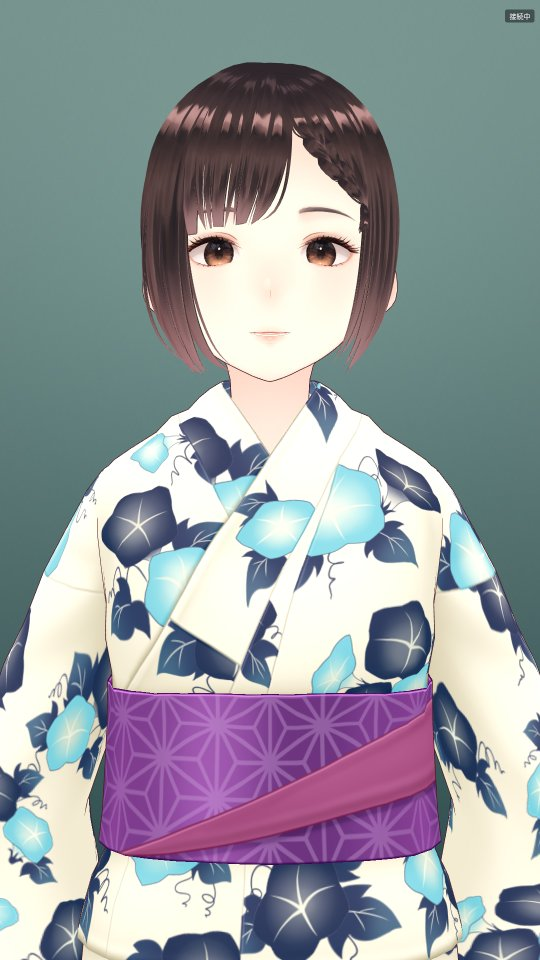
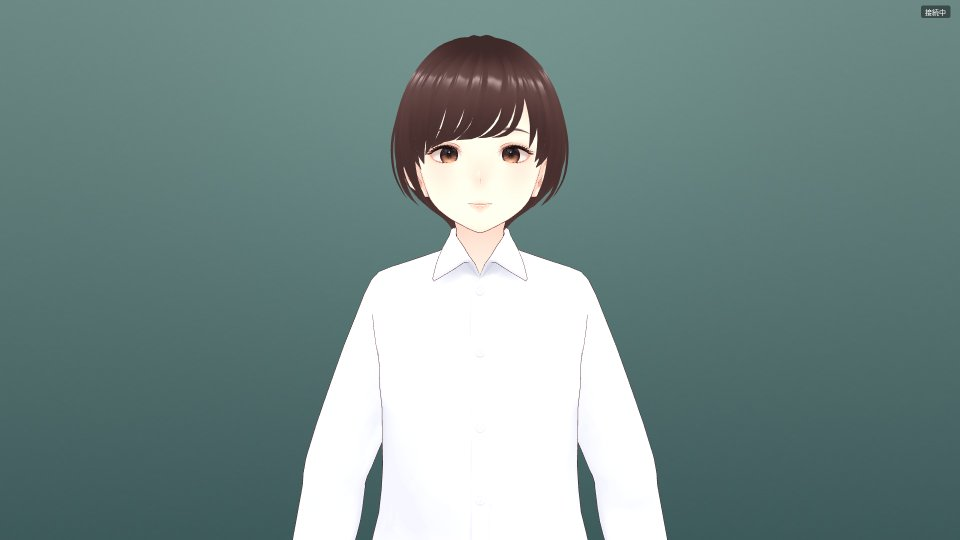
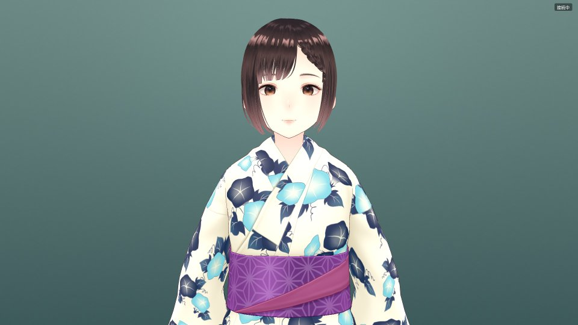
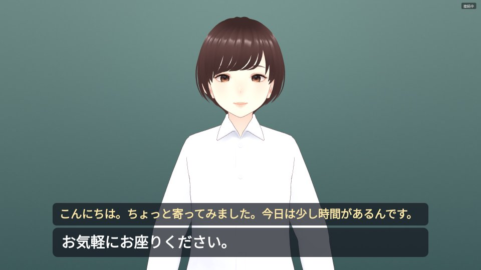

# WP08 結果 — 本番アバターとテーマの切り替え

ブランチ `feature/wp08-avatar-themes`（main `d629d89` から）。確認は作業用のデータディレクトリ（知識パック・重み・アバターはリンク）と
別ポート（http 18080・ws 18765）で行い、`~/idobata-data` には書いていない。

## 1. 本番アバター

`~/idobata-data/avatars/` の 2 体を本番アバターにした。**git にもエッジのビルドにも入れず**、フロントが `/edge/avatars/<name>.vrm` で配信する
（`.gitignore` に `idochan_*.vrm`）。開発用のサンプル（`edge/public/models/VRM1_Constraint_Twist_Sample.vrm`）は既定値として残し、
フロントにつながらないまま 4 秒経ったとき、テーマのアバターのファイルが無いとき、読み込みに失敗したときに出す。

### VRM 内のメタ情報（`VRMC_vrm.meta` をそのまま転記）

2 体とも同じ値（サムネイル画像は除く）。

| 項目 | 値 |
|---|---|
| ファイル | `idochan_office.vrm`（16,229,680 バイト、sha256 `318dd4c4ed60658d5720d9456ac7302a996e09a055184a3c151cf01c6e733ddc`）<br>`idochan_festival.vrm`（19,469,116 バイト、sha256 `7117d062006fe77b4615a598e5fb10cac6ce9a64c77669065de31e333e4fe0a3`） |
| 生成 | VRoid Studio-2.14.0（glTF 2.0、`VRMC_vrm` specVersion 1.0） |
| name（タイトル） | いどちゃん |
| authors（作者） | 富士製作所 |
| copyrightInformation | @2026 Fuji Enginerring LLC |
| licenseUrl | https://vrm.dev/licenses/1.0/ |
| avatarPermission | onlySeparatelyLicensedPerson（別途許諾を受けた人だけがアバターとして使える） |
| commercialUsage | corporation（法人の商用利用まで可） |
| creditNotation | required（クレジット表記が必要） |
| allowRedistribution | false（再配布不可） |
| modification | prohibited（改変不可） |
| allowExcessivelyViolentUsage | false |
| allowExcessivelySexualUsage | false |
| allowPoliticalOrReligiousUsage | false |
| allowAntisocialOrHateUsage | false |

- 元は AvatarSample_W を当社が改変（作業指示より。VRM のメタには元モデルの記載は無い）
- copyrightInformation の綴りは VRM に入っているまま（「Enginerring」）。直すなら VRoid Studio で書き出し直す
- **再配布不可**なので、配信はエッジの許可（`IDOBATA_EDGE_ALLOW`、既定はこの機体だけ）の中に限る。`/edge/avatars/` は
  `/edge/` と同じ許可の検査を通る（許可の無い機体からは 403、テストあり）
- **クレジット表記が必要**: 画面のどこに出すか（エッジの隅・掲示物など）は未決（残っていること 1）

## 2. テーマの切り替え（`server/context/themes.yaml`、`src/themes.py`）

| 拠点 | テーマ | アバター | 背景 | 季節の一言 |
|---|---|---|---|---|
| etajima / akiota | spring（3/1〜5/31） | idochan_office.vrm | `<拠点>_spring.jpg` | 春らしくなってきましたね。 |
| | summer（6/1〜8/31） | idochan_office.vrm | `<拠点>_summer.jpg` | 夏らしくなってきましたね。 |
| | autumn（9/1〜11/30） | idochan_office.vrm | `<拠点>_autumn.jpg` | すっかり秋らしくなりましたね。 |
| | winter（12/1〜2/29） | idochan_office.vrm | `<拠点>_winter.jpg` | 寒い季節になりましたね。 |
| | festival（暦は未設定） | idochan_festival.vrm | `<拠点>_autumn.jpg` | お祭りの季節ですね。 |

- **暦（月日）で自動で選ぶ**: `calendar` を上から見て最初に当たったもの（`MM-DD`、両端を含む、年をまたいでよい）。
  お祭りの期間は市の行事の日付を確かめていないので**暦には入れていない**（コメントで書き方だけ置いた。それまでは職員パネルから手動）
- **職員パネル（`/staff/`）から手動で**: 「アバターと背景」の欄のボタン（春・夏・秋・冬・お祭り・自動に戻す）。
  手動は「自動に戻す」まで続き、再起動で自動に戻る。API は `GET/POST /staff/api/theme`（Basic 認証・LAN のみ、既存と同じ）
- **会話中は切り替えない**: フロントが 5 秒ごとに見て、切り出していない・来訪者の発話が無い（会話が区切られた）・応答中でない、
  カメラがあれば輪が NONE のときだけ、`theme` メッセージをエッジに送る。輪が解けても、会話が区切られる（輪が無くなって 8 秒・
  待機タイムアウト）までは送らない
- **`theme` メッセージ**: `{type, site, season, name, avatar, background}`。`avatar`・`background` はエッジのページからの相対パス
  （`avatars/idochan_office.vrm`、`backgrounds/etajima_autumn.jpg`）。`site`・`season` は WP01 の形を残した（`season` にはテーマ名）
- **ブラウザ側**: 届いたアバターが今と違えば読み直す。読み終わるまでは前のモデルを出したまま、読み込み中に次の切り替えが来たら古い方は
  捨てる、前のモデルは `VRMUtils.deepDispose` で GPU から外す。背景は CSS の `background-image` を差し替える
- **切り出しの季節の一言**: 寒暖の一言（10℃ 未満・30℃ 超）があればそちら。無ければ天気の一言と 1 会話おきに入れ替える（天気が
  分からなければ毎回）。事前合成の対象に全テーマの一言を足した。拠点の行事や景色など確かめていない事実は書いていない
- アバターのファイルが無いテーマは、WARNING を出して開発用のサンプルで出す（落ちない）

## 3. 新しい VRM での口パク・表情・まばたき・視線

両モデルの表情のプリセット（`VRMC_vrm.expressions.preset`）: aa・ih・ou・ee・oh・happy・relaxed・angry・sad・surprised・
blink・blinkLeft・blinkRight・neutral（カスタムなし）。視線は bone 型（`lookAt.type: bone`）、ヒューマノイドの骨 54 本
（head・neck・chest・upperChest・spine・leftEye などあり）。

- **無い表情は使わない**: 読み込んだときに、使う表情（happy・relaxed・blink・aa・ih・ou・ee・oh）のうちモデルにあるものだけを覚え、
  無いものはコンソールに 1 回 WARNING を出して以後は値を入れない。今の 2 体は全部ある
- `--edge` の 3 往復（下の 6 章）の間、50ms ごとに表情の重みと視線を取った（1,191 点）

| 項目 | 最大値・範囲 | 判定 |
|---|---|---|
| 口形 aa・ih・ou・ee・oh | 5 つとも 0.85（`MOUTH_OPEN`）まで動く | 動く |
| blink | 0.87（0.15 秒のまばたきを途中で取った値） | 動く |
| happy | 0.10（待機）〜0.25（話している） | 状態で変わる |
| relaxed | 0.15（待機） | 入る |
| 視線（lookAt の yaw・pitch、度） | yaw 0〜8.2、pitch −6.0〜7.1 | 考え中に外して戻る |

テーマの切り替え後（祭りのアバター）でも、使える表情の一覧は同じ 8 つだった。

## 4. 構図と背景の明るさ

- **構図をモデルから取る**: 前はサンプルに合わせた固定値（頭の骨から 1.35 m）。新しいモデルでは、頭のてっぺん（モデルの外形の上端。
  頭の骨 + 0.4 m で頭打ち）・胸（upperChest の骨）・肩幅（左右の上腕の骨の間）から決める。頭の上に画面の高さの 7% を空け、
  胸の骨の 8cm 下までを画面の上 80% に収める。縦置きで幅が足りないときは、肩幅の 2.1 倍が入るまで引く。カメラは水平
  （見上げ・見下ろしにしない）。画面の縦横が変わったら取り直す
- **背景は少し濃いめ**: 上（頭の後ろ）が明るく、下（胸のあたり、白いシャツ）ほど濃い。下端の明るさは江田島で RGB 18〜40 前後・
  安芸太田で 24〜54 前後。CSS の既定の背景（画像が無いとき）も同じ系統の濃い青緑に変えた（前は明るいベージュ）
- スクリーンショットは Playwright のヘッドレス Chromium（WebGL は SwiftShader）で撮った。実機の Chrome（GPU）で同じ見え方かは
  残っていること 3

### 縦置き 1080×1920（撮った画像を半分に縮小）

| 通常（秋・江田島） | お祭り |
|---|---|
|  |  |

### 横置き 1920×1080

| 通常（秋・江田島） | お祭り |
|---|---|
|  |  |

話しているとき（字幕あり。口が開いている）:



## 5. 背景の仮置き

`scripts/make_backgrounds.py` で作り直せる（`cd server && uv run python ../scripts/make_backgrounds.py`）。1920×1920 の正方形
（縦置き・横置きのどちらでも `background-size: cover` で切り出す）、頭の後ろを少し明るくする楕円と、縞が出ないための微かな粒を足した。

| 拠点 | 色味 | 季節での振り方 |
|---|---|---|
| 江田島 | 海の青緑 | 春は柔らかい青緑、夏は鮮やかな青、秋は灰がかった緑、冬は青灰 |
| 安芸太田 | 山の深緑 | 春は若草、夏は深緑、秋はオリーブ（黄みの緑）、冬は灰緑 |

**実写に差し替える**: `~/idobata-data/backgrounds/` に同じ名前（`etajima_autumn.jpg` など）で置けば、フロントの
`/edge/backgrounds/<name>` がそちらを優先して返す（ビルドもし直し不要）。名前を変えるなら themes.yaml の `background` を書き換える。

## 6. 確認

### --edge で 3 往復（WAV、コミット a08e7ad、カメラなし）

ヘッドレス Chromium のエッジに、来訪者役の WAV を「マイク」として流した（あいさつ → 手続きの質問 → 雑談）。

| 往復 | ASR | 相槌の音声開始 | LLM 1 文目確定 | 音声開始 | LLM 完了 |
|---|---|---|---|---|---|
| 1 | 0.51s | 0.56s | 1.40s | **0.56s** | 2.63s |
| 2 | 0.70s | 0.71s | 1.40s | **0.71s** | 3.00s |
| 3 | 0.66s | 0.67s | 1.48s | **0.67s** | 2.22s |

音声開始は 3 往復とも 1.3 秒未満。ただし、音声開始は相槌（WP04）の音で、LLM の 1 文目が確定するのは 1.40〜1.48 秒。

### テーマの切り替え（同じ回）

| 確認 | 結果 |
|---|---|
| 最初の接続で今のテーマ（10/22 → autumn） | `/edge/avatars/idochan_office.vrm`・`backgrounds/etajima_autumn.jpg` |
| 職員パネルの API で festival（会話の無いとき） | 縦置き 11.7 秒・横置き 6.2 秒で祭りのアバターに替わった（5 秒ごとの確認＋ 16〜19MB の読み込み） |
| 自動に戻す | 秋（office）に戻った |
| 3 往復の直後（会話中）に festival | 8 秒待っても office のまま（`applied: autumn`、`wanted: festival`） |

### テスト

```
uv run pytest            → 390 passed, 5 deselected（integration）
uv run mypy --strict src → Success: no issues found in 31 source files
uv run ruff check . ../scripts → All checks passed!
(cd edge && npm run build) → tsc --noEmit と vite build が通る
```

追加（`tests/test_wp08_unit.py`）: 暦（季節の境目・年またぎ・2/29・祭りの期間が優先）、全テーマに仮置きの背景がある、壊れた・不正な
ファイル名の themes.yaml は空、ファイル名の検査、手動の切り替えと状態、季節の一言と天気の一言の入れ替え、アバター・背景の配信（実写の
優先・仮置き・無いもの 404・ディレクトリをさかのぼる名前・許可の無い機体 403）、職員パネルの API、会話中・輪が解けた直後は切り替えず
区切られてから切り替える、アバターのファイルが無ければサンプル、切り出しが今のテーマの一言を使う。
WP01 の `current_season` のテストは、暦のテストに置き換えて消した。

### その他

- `THREE.Clock`（three r186 で非推奨の警告）を `THREE.Timer` に替えた
- 確認用に、エッジのページに `window.__avatarDebug()`（URL・使える表情・今の重み・視線・カメラの位置）を置いた。値を読むだけ
- `deploy/standalone/.env.example` に設定は足していない（`.env` との差分の報告は無し）
- この機体で `nvidia-smi` が「Driver/library version mismatch」を返す（ドライバの更新の後、再起動していない様子）。動いている
  コンテナ（ASR・LLM）は応答している。VRAM は測れなかった。再起動は人間の判断で

## 残っていること

1. **クレジット表記**（`creditNotation: required`）をどこに出すか。エッジの画面の隅に小さく出すか、ロビーの掲示に書くか
2. お祭りの**期間**（市の行事の日付）を確かめて、themes.yaml の `calendar` に入れる
3. 実機の Chrome（GPU）と縦置きのディスプレイで、構図と背景の明るさを見る（今回の画像はヘッドレスの SwiftShader）
4. 実写の背景を市から受け取ったら `~/idobata-data/backgrounds/` に置く。実写は明るさが合わない可能性があるので、そのときに
   白いシャツとの境目を見る
5. copyrightInformation の綴り（「Enginerring」）を直すか
