# WP10 結果: 背景の実写化（Wikimedia Commons）とクレジット表示

2026-10-23。ブランチ `feature/wp10-backgrounds`。

## 1. やったこと

1. `scripts/fetch_commons_backgrounds.py`: Commons の API で拠点ごとに検索・カテゴリをたどり、CC0・CC BY・CC BY-SA（4.0／3.0）の
   横長（幅 1600px 以上）だけを候補にした（安芸太田 37 枚・江田島 20 枚）。一覧シートは `docs/img/bg_candidates_<site>.png`、
   元の URL・撮影者・ライセンス・ページの URL は `~/idobata-data/backgrounds/candidates/<site>/candidates.json`
2. **人間が 8 枚を選んだ**（拠点×季節。お祭りのテーマは秋の背景を使う）
3. `scripts/apply_background.py`: 選んだ番号（または Commons のファイル名）から、メタデータを API で取り直してライセンスを確かめ、
   原寸を取って 1920×1080 に切り出し、`~/idobata-data/backgrounds/<site>_<season>.jpg` と `credits.json` に書く
4. エッジの画面右下に写真のクレジット（CC BY・CC BY-SA のときだけ）。縦置きで見せる横の位置（anchor）もテーマと一緒に送る
5. 実写が無い季節・`credits.json` に無い背景は、これまでどおり `edge/public/backgrounds/` のイラストに落ち、クレジットは出さない

## 2. 選定（拠点×季節）

| 拠点・季節 | 写真 | 撮影者 | ライセンス | 元の寸法 | 撮影日 | 切り出し | anchor |
|---|---|---|---|---|---|---|---|
| 安芸太田・秋 | [三段滝（三段峡）](https://commons.wikimedia.org/wiki/File:%E4%B8%89%E6%AE%B5%E6%BB%9D.jpg)（候補 01） | HKT3012 | CC BY-SA 4.0 | 7952×5304 | 2019-11-13 | 幅 1920 に縮小、上 80px・下 121px を切る | center |
| 安芸太田・冬 | [Osorakan ski resort](https://commons.wikimedia.org/wiki/File:Osorakan_ski_resort.jpg)（候補外。初雪の恐羅漢スキー場） | As6673 | パブリックドメイン | 2304×1728 | 2009-11-04 | 幅 1920 に縮小、上 144px・下 216px | center |
| 安芸太田・春 | [井仁の棚田](https://commons.wikimedia.org/wiki/File:%E4%BA%95%E4%BB%81%E3%81%AE%E6%A3%9A%E7%94%B0_Ini_District_Hiroshima_AkiOota_-_panoramio.jpg)（候補 36） | full moon69 | CC BY 3.0 | 1600×1200 | 2009-05-09 | 幅 1920 に**拡大**、上 144px・下 216px | center |
| 安芸太田・夏 | [三つ滝（三段峡）](https://commons.wikimedia.org/wiki/File:Mitsudaki_1.jpg)（候補 22） | かるちる | CC0 | 2700×1800 | 2011-09-26 | 幅 1920 に縮小、上 80px・下 120px | center |
| 江田島・春 | [牡蠣筏と島影（Kumihama Bay）](https://commons.wikimedia.org/wiki/File:Kumihama_Bay2.JPG)（候補 07） | At by At | CC0 | 4288×3216 | 2011-05-05 | 幅 1920 に縮小、上 144px・下 216px | center |
| 江田島・夏 | [沖美の砂浜](https://commons.wikimedia.org/wiki/File:%E6%B2%96%E7%BE%8E_-_panoramio_(1).jpg)（候補 03） | warabi hatogaya | CC BY 3.0 | 2408×1806 | 8 月 15 日 | 幅 1920 に縮小、上 144px・下 216px | center |
| 江田島・秋 | [Etajima Island](https://commons.wikimedia.org/wiki/File:Etajima_Island._-_panoramio.jpg)（候補 12） | 柳田亮 | CC BY-SA 3.0 | 3647×2427 | 1 月 3 日 | 幅 1920 に縮小、上 79px・下 119px | center |
| 江田島・冬 | [弥山から南東の眺め](https://commons.wikimedia.org/wiki/File:View_to_the_southeast_from_Misen_(Hiroshima).jpg)（候補 09） | Christophe95 | CC BY-SA 4.0 | 4032×3024 | 2018-09-23 | 幅 1920 に縮小、上 144px・下 216px | center |

- 切り出し: 幅 1920 に合わせ、高さの余りを **上 40%・下 60%** で切る（空を残して手前を切る）。8 枚とも 4:3 か 3:2 なので左右は切らない
- 下を暗くする: 下から 60% の範囲で、下端を最大 45% 暗く（最初は下 35%・最大 35% にしたが、横置きのスクリーンショットで
  白いシャツが明るい雪・海・空に溶けたので強めた）。明るい上（頭の後ろ）はそのまま
- 撮影日はメタデータのまま。**江田島・秋の写真は 1 月 3 日、江田島・冬の写真は 9 月 23 日の撮影**で、季節の割り当ては見た目による
  （人間の選定どおり）。江田島・冬は宮島の弥山（廿日市市）から江田島方面を見た写真
- 安芸太田・春は原寸が 1600px なので 1.2 倍に拡大している（縦置きのディスプレイでは少し甘く見える可能性がある）

### 縦置きで見せる位置（anchor）

縦置き 1080×1920 では、1920×1080 の背景の横の 1/3 弱（608px 分）だけが見える。縮小後のプレビュー（`~/idobata-data/backgrounds/previews/`、
左・中央・右の窓を重ねた画像）で 8 枚とも主題（滝・棚田・ゲレンデ・牡蠣筏・島影・浜）が中央の窓に入ったので、**全部 center**。
ただし縦置きでは **アバターが画面の幅をほぼ占めるので、見えるのは肩より上の部分だけ**（中央の主題はアバターの後ろ）。
横置きでも、中央にある主題（安芸太田・秋の三段滝、江田島・春の牡蠣筏の中ほど）はアバターに隠れる（3 章）。

## 3. スクリーンショット

WP08 と同じ方法（`--edge`・カメラ無しのアプリに Playwright のヘッドレス Chromium、WebGL は SwiftShader）。職員パネルの API でテーマを
手動に切り替え、横 1920×1080・縦 1080×1920 で撮った（画像は半分に縮小）。

| 拠点・季節 | 横 | 縦 |
|---|---|---|
| 安芸太田・秋 | 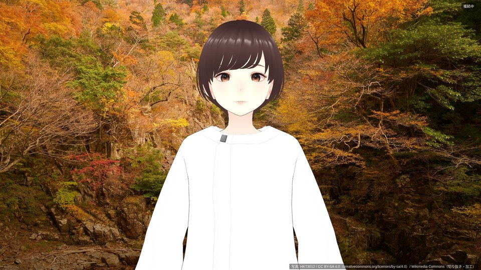 | 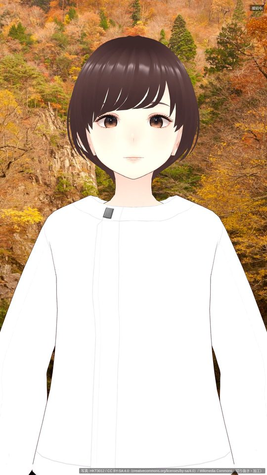 |
| 安芸太田・冬 | 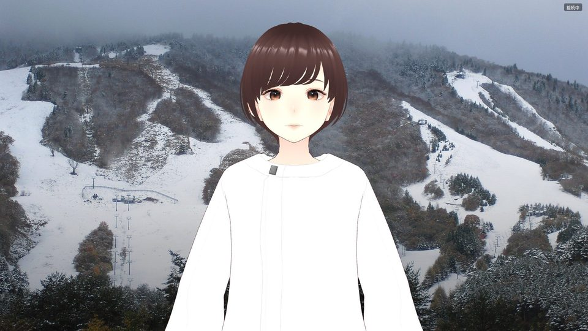 | 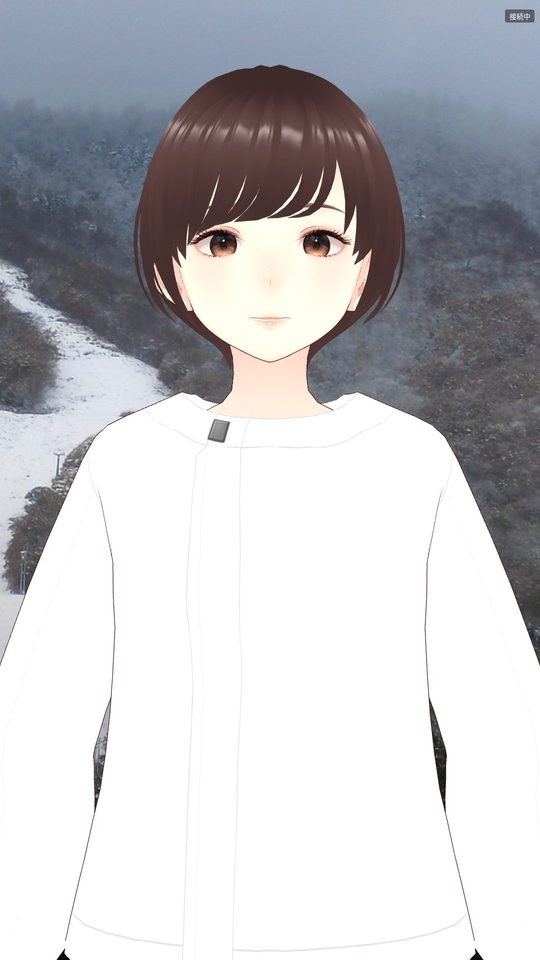 |
| 安芸太田・春 | 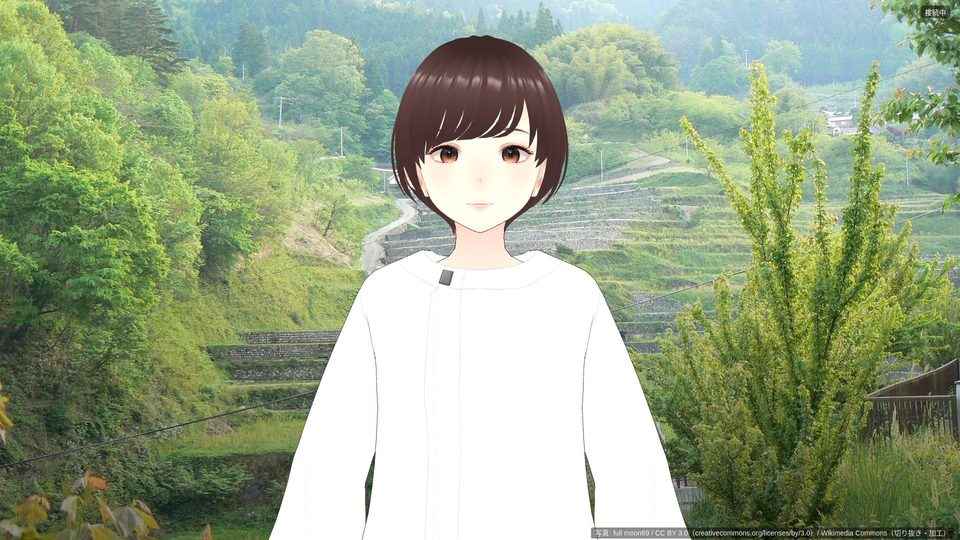 | 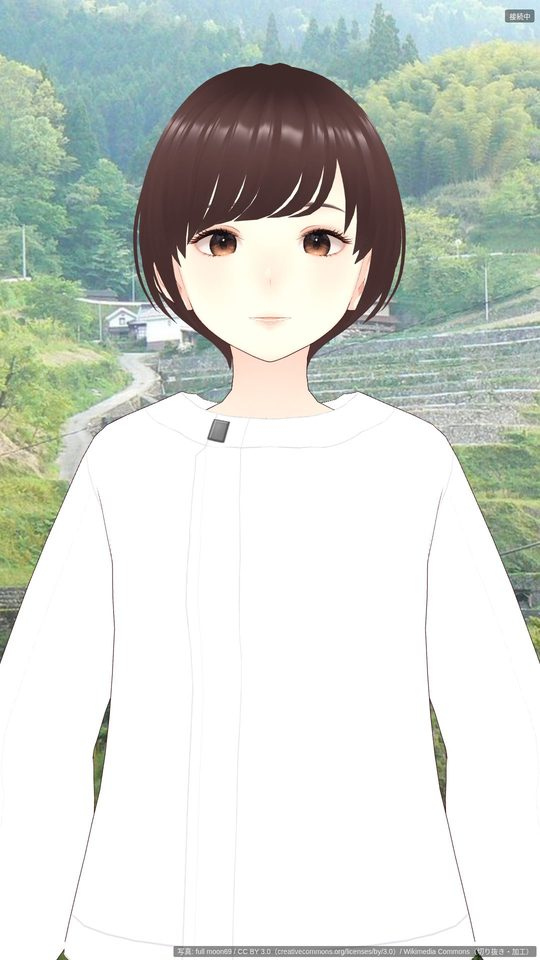 |
| 安芸太田・夏 | 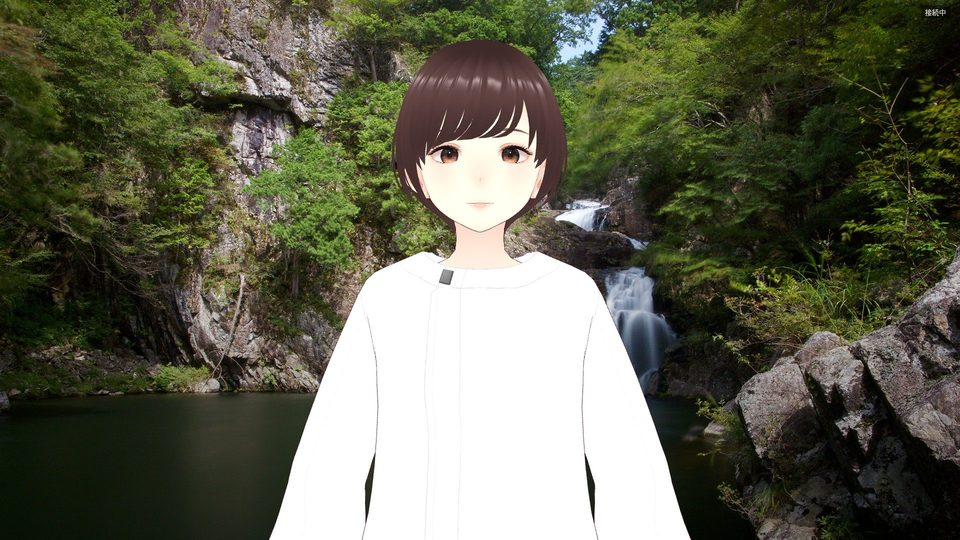 | 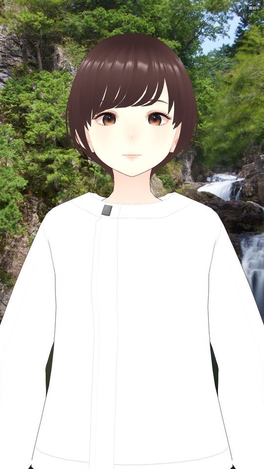 |
| 江田島・春 | 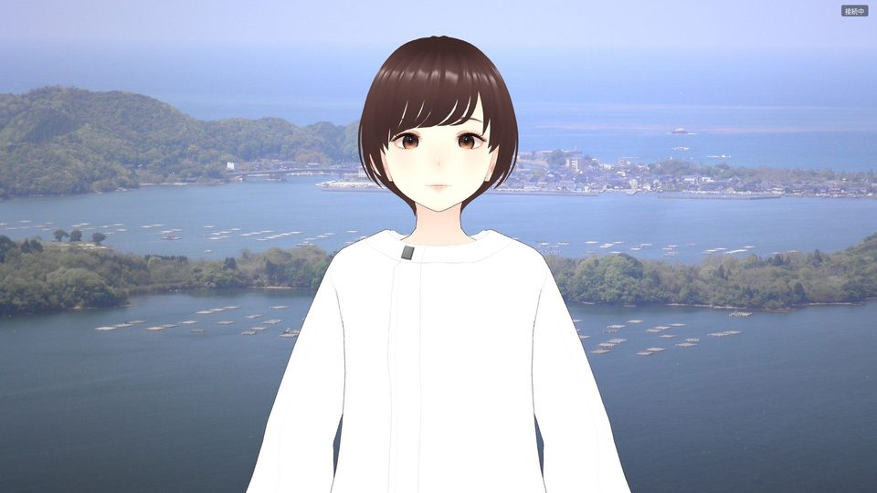 | 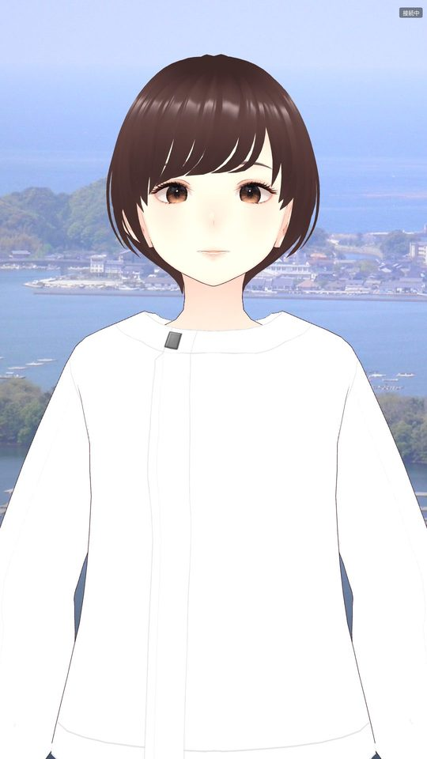 |
| 江田島・夏 | 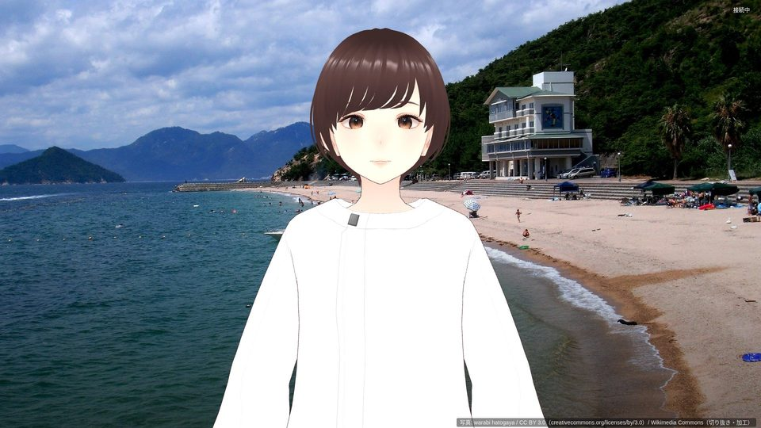 | 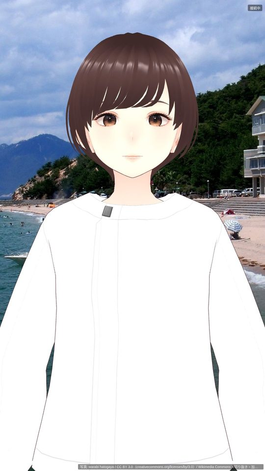 |
| 江田島・秋 | 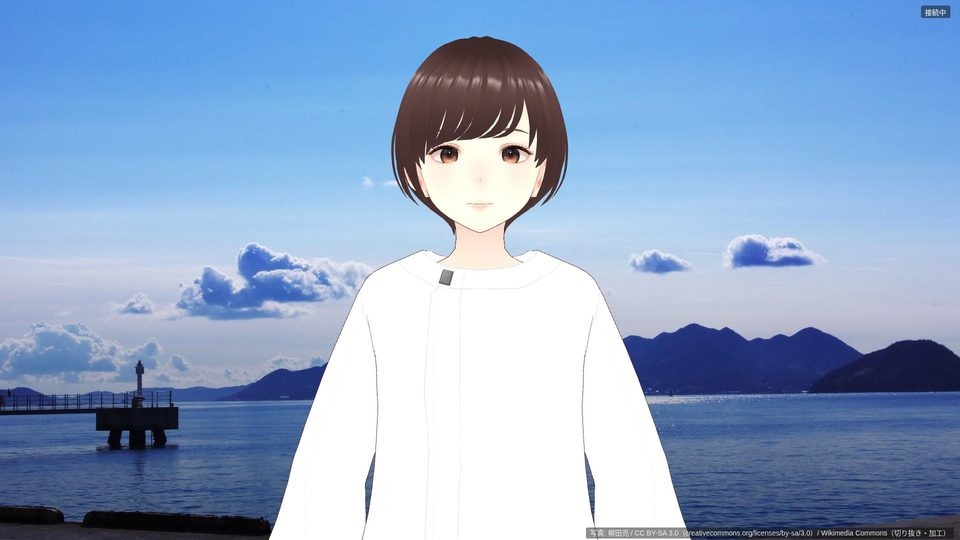 | 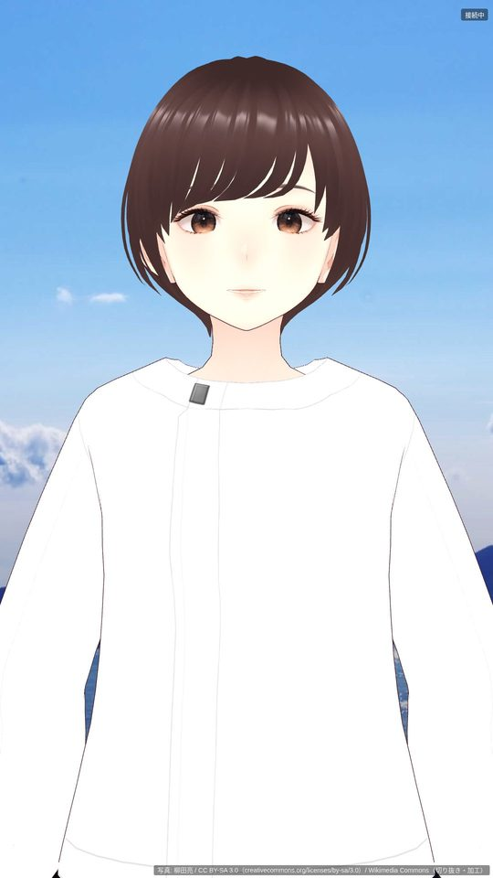 |
| 江田島・冬 | 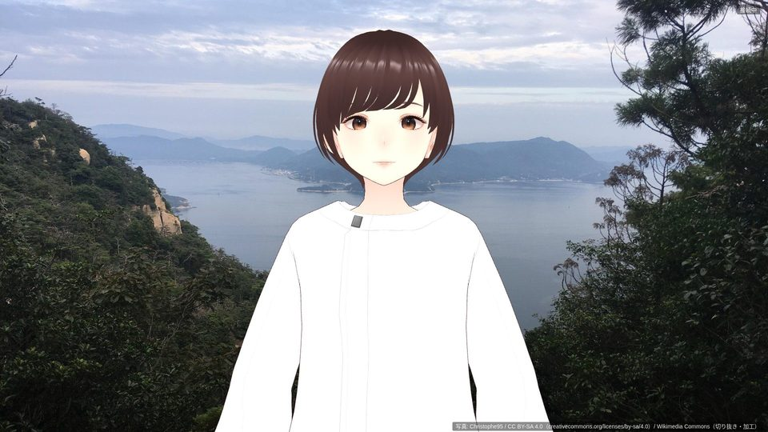 | 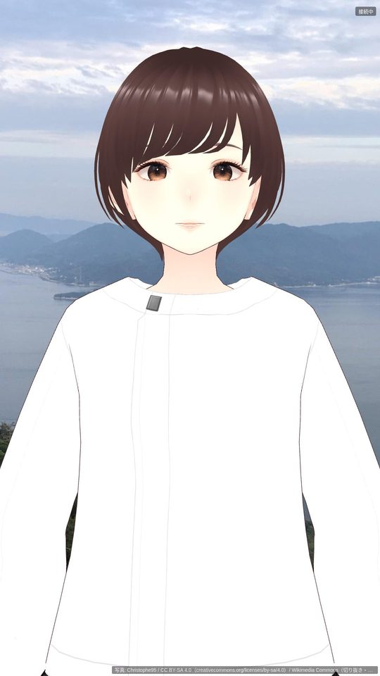 |

目で見たこと:

- **クレジットと字幕は重ならない**（要素の位置で確認: 横置きでクレジットは y=1055〜1077、字幕の枠の下端は y=1053。縦置きでクレジットは
  y=1892〜1914、字幕の枠の下端は y=1872）。横置きでは隙間が 2px しかないので、字幕を下げる変更をするときは注意
- 白いシャツ: 下を暗くした後は、雪（安芸太田・冬）と明るい海・空（江田島の春・秋・冬）でもシャツの輪郭が分かる。肩の高さ
  （画面の上から 40% 前後）は暗くする範囲の端なので、肩の線は薄い背景に近い
- 横置きでは、**安芸太田・秋の三段滝がアバターの真後ろに隠れる**（周りの紅葉で秋とは分かる）。主題を左右にずらすには、
  拡大して横にずらす切り出しが要る（今のスクリプトは幅に合わせるだけ）。直すかは判断を待つ
- 江田島・夏は浜に人が小さく写っている（顔は判別できない大きさ）。右端に建物
- 実機の Chrome（GPU）・縦置きディスプレイでの見え方は未確認（残タスク 1-2）

## 4. クレジット表示の仕組み

- `~/idobata-data/backgrounds/credits.json`（`apply_background.py` が書く。git に入れない）: 拠点×季節ごとに
  `file, commons_title, commons_url, original_url, author, license, license_url, credit_required, date, description, original_size, crop, anchor, applied_at`
- サーバ（`themes.background_credit`）: テーマを送るとき、**実写のファイルが `~/idobata-data/backgrounds/` にあり、`credits.json` に
  その file があるときだけ** 文言を作る。`credit_required` が false（CC0・パブリックドメイン）なら文言は空（anchor だけ使う）。
  文言は `ThemeConfig.credit_format`:
  `写真: {author} / {license}（{license_url}）/ {source}（切り抜き・加工）`
  （例「写真: HKT3012 / CC BY-SA 4.0（creativecommons.org/licenses/by-sa/4.0）/ Wikimedia Commons（切り抜き・加工）」。source は既定で Wikimedia Commons）
- theme メッセージに `background_credit`・`background_anchor` を足した（`edge/src/protocol.ts` で optional。古いエッジは無視する）
- エッジ: 右下に 14px・行の高さ 18px（帯の高さ 22px）、半透明の黒い帯に白文字。文言が空なら要素ごと隠す。背景の切り替えと一緒に替わる。
  縦置きでは `background-position` の横位置を anchor にする
- 1-5 の「いどちゃん／富士製作所」のクレジットはこの WP では入れていない

## 5. ライセンスの扱い

| ライセンス | 枚数 | 画面での表示 | 改変（切り抜き・下を暗く）について |
|---|---|---|---|
| CC BY-SA 4.0 | 2（安芸太田・秋、江田島・冬） | 撮影者・ライセンス名・ライセンスの URI・出所・加工したこと | 翻案物に当たり得る。共有するなら同じライセンス（継承） |
| CC BY-SA 3.0 | 1（江田島・秋） | 同上 | 同上（3.0 の「Adaptation」） |
| CC BY 3.0 | 2（安芸太田・春、江田島・夏） | 同上 | 改変は自由。表示と改変したことの表示が要る |
| CC0 | 2（安芸太田・夏、江田島・春） | 出さない | 制限なし。出所は `credits.json` に残す |
| パブリックドメイン | 1（安芸太田・冬） | 出さない | 同上 |

- **表示の義務**: CC BY / BY-SA は、撮影者（帰属）・ライセンスの URI かハイパーリンク・改変したことを示す（4.0 第3条(a)(1)）。
  4.0 は「共有する媒体・方法・文脈に照らして、いかなる合理的な方法でも満たすことができ」るとしている。ロビーの画面ではリンクを押せないので、
  ライセンスの URI を短い形で文言に入れ、Commons のページの URL は `credits.json` に残した
- **CC BY-SA の継承（ShareAlike）**: トリミングと明るさの調整は翻案（4.0 の「翻案物」= 改変・変形などで元から派生したもの）に当たり得る。
  背景ファイルを配布する場合は同じライセンス（CC BY-SA の同じか後のバージョン）にする。**背景ファイルは本リポジトリに含めず
  `~/idobata-data/` に置くので、ファイルの配布は発生しない**
  - ただし 4.0 の「共有」の定義には **公開の展示** も入っている（「複製、公開の展示、公開の上演・演奏、頒布…により、公衆に対しマテリアルを
    提供すること」）。ロビーの画面に出すことが共有に当たると読むなら、画面に出している加工後の画像も CC BY-SA 4.0 の下にあることになる。
    画面の文言は撮影者・ライセンス・URI・加工したことを含むので、表示の条件はこれで満たすと考える。加工後の画像をほかの条件で使わせる
    つもりはないので、継承の条件とぶつかることもない。**判断が要るときは市の法務に確かめてほしい**
- 一覧シート（`docs/img/bg_candidates_<site>.png`）は縮小した候補の並べ（撮影者・ライセンスを印字）で、リポジトリに入っている。
  これも撮影者・ライセンスの表示つき。気になるなら一覧シートはリポジトリから外せる
- 参照したライセンスの本文（2026-10-23 に開けることを確認）:
  - CC BY-SA 4.0: https://creativecommons.org/licenses/by-sa/4.0/legalcode.ja（要約 https://creativecommons.org/licenses/by-sa/4.0/deed.ja）
  - CC BY-SA 3.0: https://creativecommons.org/licenses/by-sa/3.0/legalcode（要約 https://creativecommons.org/licenses/by-sa/3.0/deed.ja）
  - CC BY 3.0: https://creativecommons.org/licenses/by/3.0/legalcode（要約 https://creativecommons.org/licenses/by/3.0/deed.ja）
  - CC0 1.0: https://creativecommons.org/publicdomain/zero/1.0/legalcode.ja
  - Commons の再利用の手引き: https://commons.wikimedia.org/wiki/Commons:Reusing_content_outside_Wikimedia

## 6. 選ばなかった候補の種類（一覧シートから）

選んだのは人間で、下は一覧シートに何が混ざっていたかの分類（選ばなかった理由そのものではない）。

| 種類 | 安芸太田 | 江田島 |
|---|---|---|
| 構造物（ダム・取水口・橋） | 06〜13・15〜18（ダム 12 枚） | 06（早瀬大橋） |
| 建物・店舗・中央に建物 | 14（文化交流センター） | 04・15（浜の建物）、08・11（小用港）、10（道と家並み・バス）、13（集落）、14（店舗） |
| 碑・神社 | — | 16・17（碑・井戸）、20（神社） |
| 人物・乗り物が目立つ | — | 01（フェリー）、02（浜の人と桟橋）、18（泳ぐ人） |
| 同じ被写体の別のカット | 02〜05（三段峡の紅葉・淵）、23（三つ滝）、34・37（井仁の棚田） | — |
| 山・川・湖の遠景（季節が分かりにくい） | 19〜21・24〜26・28〜33・35 | 05（江田島湾）、19（島影） |
| ほかの土地 | 27（廿日市市吉和） | — |

夜景はどちらの候補にも無かった。

## 7. 冬の写真と差し替え

- **冬の実写は、安芸太田は初雪（11 月初め）の 1 枚しか無い**。真冬の三段峡・恐羅漢の雪景色は Commons に見当たらなかった。
  江田島の冬は、冬らしさではなく見た目の落ち着きで選んだ（9 月の撮影）
- 市・町や観光協会の写真に差し替えるときは、**同じファイル名（`<site>_<season>.jpg`、1920×1080）で `~/idobata-data/backgrounds/` に置き、
  `credits.json` のその拠点×季節に出所（author・license・source・credit_required）を書けばよい**（再起動は要らない。次のテーマの送信から効く）。
  Commons の写真なら `apply_background.py --file "File:..."` で切り出しと記録までできる
- 市への確認事項 8 に「安芸太田：真冬の三段峡・恐羅漢の写真の提供（商用不可でも庁内掲示用途なら可か）」を足した

## 8. Commons への要求の作法

- User-Agent は `idobata-ai-backgrounds/0.1 (+Fuji Seisakusho LLC; municipal lobby guide pilot; <連絡先>)`
- `apply_background.py` は要求の間を 3 秒以上空け、429 なら 30 秒待って 1 回だけやり直し、それでもだめなら止まる。
  原寸は upload.wikimedia.org の元ファイル（thumb の URL は使わない）で、`~/idobata-data/backgrounds/.originals/` に取っておく
  （切り出しを直すときに取り直さない）。今回の適用では 429・403 は出なかった
- 候補を集めた `fetch_commons_backgrounds.py` は 0.3〜0.5 秒の間隔だった（WP10 の前半。今後回すなら 3 秒に揃える）

## 9. 品質・テスト

- 新しいテスト `server/tests/test_wp10_unit.py`（2 件）: credits.json にある実写だけクレジットを出す・CC0 は文言なしで anchor は使う・
  知らない anchor は中央・実写はあるが credits.json に無い／実写が無い（仮置きに落ちる）／credits.json が壊れているときは出さない、
  お祭りのテーマは秋の背景のクレジット、実写の無い季節は仮置きで文言なし
- `server/tests/test_wp08_unit.py` のエッジの代役を新しい引数に合わせた
